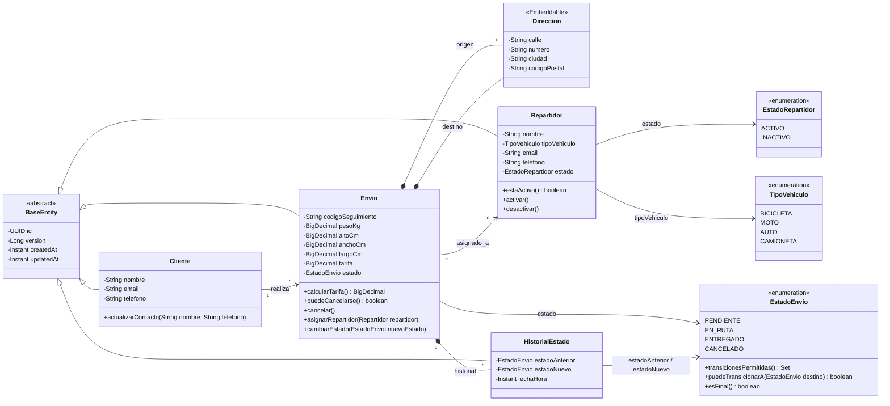

# daas-proyecto-final · LogiTrack shipment-service

Microservicio del **Sprint 1** (Desarrollo y Arquitecturas Avanzadas de Software – FI UNJu 2026).
Gestiona el ciclo de vida de los envíos, el historial de auditoría de estados y los repartidores.

| | |
|---|---|
| Lenguaje | Java 25 |
| Framework | Spring Boot 3.5 (Web, Data JPA, Validation, Actuator) |
| Base de datos | MySQL 8.4 (H2 en memoria solo para tests) |
| Documentación | springdoc-openapi (Swagger UI) |
| Tests | JUnit 5, Mockito, AssertJ, @DataJpaTest, @WebMvcTest |
| Infra | Dockerfile multi-stage + docker-compose |

---
## Modelo de dominio



Los cambios que hicimos respecto del modelo guía del PDF están explicados en la [sección 6](#6-modelo-de-dominio--cambios-respecto-del-modelo-guía).

---

## 1. Requisitos

- **JDK 25** (Temurin recomendado)
- **Maven 3.9+** — IntelliJ ya trae uno integrado; si no lo tenés instalado podés usar el del IDE
- **Docker Desktop** (o Docker Engine + Compose v2)

## 2. Levantar todo con un comando

```bash
docker compose up --build
```

- API: http://localhost:8080
- Swagger UI: http://localhost:8080/swagger-ui.html
- Health: http://localhost:8080/actuator/health
- MySQL: `localhost:3307` · usuario `logitrack` / `logitrack` · base `logitrack_shipments`

El script [`db/init/01-schema.sql`](db/init/01-schema.sql) crea las tablas y carga datos de prueba
**solo la primera vez** que se crea el volumen. Para empezar de cero:

```bash
docker compose down -v   # necesario si ya tenías la base creada: el repartidor ahora tiene email y teléfono
```

## 3. Desarrollo local (app desde el IDE)

```bash
docker compose up -d mysql        # solo la base
```

Después ejecutar `ShipmentServiceApplication` desde el IDE (o `mvn spring-boot:run`).
Los valores por defecto de `application.yml` ya apuntan a ese MySQL; se pueden pisar con variables
de entorno (`DB_HOST`, `DB_PORT`, `DB_NAME`, `DB_USER`, `DB_PASSWORD`). Ver `.env.example`.

## 4. Tests

```bash
mvn test
```

La suite **no necesita MySQL ni Docker**: usa H2 en memoria (modo MySQL). El pipeline de
GitHub Actions (`.github/workflows/ci.yml`) corre `mvn verify` en cada push y pull request;
el resultado se ve en la pestaña **Actions** del repositorio.

| Test | Tipo | Qué valida |
|---|---|---|
| `EstadoEnvioTest` | Unitario | Matriz completa de transiciones de la máquina de estados |
| `EnvioTest` | Unitario | Cálculo de tarifa, cancelación, asignación, historial |
| `RepartidorServiceTest` | Unitario (Mockito) | Registro, listados, cambio de estado (activar/desactivar) y regla de envíos en ruta |
| `AsignacionServiceTest` | Unitario (Mockito) | Asignación, reasignación, validaciones de repartidor inactivo y estados de envío |
| `RepartidorRepositoryTest` / `EnvioRepositoryTest` | Integración (`@DataJpaTest`) | Mapeo JPA, UUID, auditoría, verificación de envíos en ruta |
| `RepartidorControllerTest` | Integración (`@WebMvcTest`) | Contrato HTTP de repartidores (POST, GET, PATCH de estado), códigos 200/201/400/404/422 |
| `AsignacionControllerTest` | Integración (`@WebMvcTest`) | Contrato HTTP de asignación (PUT), códigos 200/400/404/422 |
| `GestionRepartidoresIntegrationTest` | Integración (`@SpringBootTest`) | Flujo completo e2e: registrar → listar → asignar a envío → reglas de negocio en H2 |
| `ShipmentServiceApplicationTests` | `@SpringBootTest` | El contexto completo levanta |

## 5. Estructura

```
src/main/java/ar/edu/unju/fi/logitrack/shipment
├── config/       JPA auditing, OpenAPI
├── controller/   REST controllers (solo reciben/devuelven DTOs)
├── dto/          records de request/response, uno por módulo (dto/repartidor, dto/envio, ...)
├── entity/       entidades JPA + enums + Value Object Direccion
├── exception/    excepciones de dominio + GlobalExceptionHandler (RFC 7807)
├── mapper/       conversión entidad ⇄ DTO
├── repository/   Spring Data JPA
└── service/      contratos (interfaces) de la lógica de aplicación
    └── impl/     implementaciones (@Service) con las transacciones
```

**El módulo Repartidores está completo como ejemplo de referencia** (DTO → Controller → Service →
Repository + tests de cada capa). Los módulos de envíos se implementan siguiendo el mismo patrón.

## 6. Modelo de dominio — cambios respecto del modelo guía

| Cambio | Motivo |
|---|---|
| `BaseEntity` con `id` UUID, `createdAt`, `updatedAt` y `version` | Requisito de UUID + auditoría en **todas** las entidades; `@Version` evita actualizaciones perdidas |
| Nueva entidad `HistorialEstado` | Trazabilidad de cada cambio de estado (estado anterior, nuevo, fecha/hora) |
| `BigDecimal` en lugar de `Double` para peso, medidas y tarifa | Evitar errores de redondeo con dinero |
| `TipoVehiculo` enum en lugar de `String` | Valores consistentes y validables |
| `Direccion` como `@Embeddable` inmutable | Value Object sin identidad; se guarda en columnas `origen_*` / `destino_*` |
| Máquina de estados en `EstadoEnvio.transicionesPermitidas()` | Una sola fuente de verdad para las transiciones |
| `Envio` sin setters: `cambiarEstado()`, `cancelar()`, `asignarRepartidor()` | Las reglas no se pueden saltear; cada cambio de estado agrega historial automáticamente |
| Código de seguimiento `LT-XXXXXXXXXX` (`TrackingCodeGenerator`) | Legible, sin caracteres ambiguos |

**Reglas de negocio implementadas en el dominio**

- Flujo: `PENDIENTE → EN_RUTA → ENTREGADO`, o `PENDIENTE → CANCELADO`. Cualquier otra transición → 422.
- Solo se cancela en `PENDIENTE`.
- Para pasar a `EN_RUTA` el envío debe tener repartidor; solo se asignan repartidores `ACTIVO` a envíos `PENDIENTE`.
- **Tarifa** (provisoria, a validar con el equipo): `1500 + 450 × máx(peso real, peso volumétrico)`,
  con peso volumétrico = `alto × ancho × largo / 5000`. Las constantes están en `Envio`.

## 7. API

Base: `/api/v1`. Errores en formato `application/problem+json`:
400 (validación / formato), 404 (no existe), 409 (dato duplicado), 422 (regla de negocio).

| Método | Endpoint | Descripción | Estado |
|---|---|---|---|
| POST | `/repartidores` | Registrar repartidor (nombre, vehículo, email único y teléfono) | ✅ |
| GET | `/repartidores?estado=ACTIVO` | Listar repartidores (todos o activos) | ✅ |
| GET | `/repartidores/{id}` | Detalle de un repartidor | ✅ |
| PUT | `/repartidores/{id}` | Actualizar nombre, vehículo, email y teléfono | ✅ |
| PATCH | `/repartidores/{id}/estado` | Activar o desactivar repartidor | ✅  |
| PUT | `/envios/{id}/repartidor` | Asignar repartidor `{ "repartidorId": "..." }` | ✅  |
| POST | `/envios` | Registrar envío (cliente, origen, destino, peso, medidas) | ✅ |
| GET | `/envios/{id}` | Consultar por id | ✅ |
| GET | `/envios/seguimiento/{codigo}` | Consultar por código de seguimiento | ✅ |
| GET | `/envios?estado=PENDIENTE&repartidorId=...` | Listar por estado y/o por repartidor asignado (hoja de ruta) | ✅ |
| PATCH | `/envios/{id}/estado` | Cambiar estado `{ "estado": "EN_RUTA" }` | ✅ |
| POST | `/envios/{id}/cancelacion` | Cancelar (solo PENDIENTE) | ✅ |
| GET | `/envios/{id}/historial` | Historial de estados | ✅ |

### Demo de Endpoints 

Los archivos [`http/envios.http`](http/envios.http) (ciclo de vida del envío) y [`http/repartidores.http`](http/repartidores.http) contienen todos los requests listos para ejecutar desde IntelliJ IDEA o VS Code (con la extensión REST Client):

1. **Registrar repartidor:** `POST /api/v1/repartidores`
2. **Listar disponibles:** `GET /api/v1/repartidores?estado=ACTIVO`
3. **Detalle de repartidor:** `GET /api/v1/repartidores/{id}`
4. **Asignación exitosa:** `PUT /api/v1/envios/{envioId}/repartidor` con repartidor activo y envío en `PENDIENTE` (200 OK).
5. **Reasignación:** `PUT /api/v1/envios/{envioId}/repartidor` sobre un envío que ya tiene repartidor pero continúa `PENDIENTE` (200 OK).
6. **Rechazo por inactivo:** Asignar repartidor en estado `INACTIVO` (422 Unprocessable Entity).
7. **Rechazo por estado de envío:** Asignar a un envío en `EN_RUTA` o `CANCELADO` (422 Unprocessable Entity).
8. **Cambio de estado:** `PATCH /api/v1/repartidores/{id}/estado` a `INACTIVO` (200 OK si no tiene envíos en ruta).
9. **Protección de repartidor:** `PATCH /api/v1/repartidores/{id}/estado` a `INACTIVO` sobre un repartidor con envíos en `EN_RUTA` (422 Unprocessable Entity).

## 8. Flujo de trabajo en Git

- `main`: versión entregable, protegida (solo pull requests).
- `develop`: integración del sprint.
- `feature/<n°-issue>-<descripcion-corta>` → pull request hacia `develop`, con al menos una revisión.
- Commits estilo *Conventional Commits*: `feat: ...`, `fix: ...`, `test: ...`, `docs: ...`, `chore: ...`.

### Reparto sugerido de tareas (un issue + una rama por tarea)

| # | Tarea | Rama sugerida |
|---|---|---|
| 1 | Base del proyecto, Docker, dominio y módulo repartidores | `feature/1-base-proyecto` ✅ |
| 2 | Registrar envío: `EnvioRequest/Response`, `EnvioMapper`, cliente buscar-o-crear por email, `ShipmentService.registrar`, `POST /envios` | `feature/2-registro-envios` |
| 3 | Consultas: por id, por código de seguimiento, por estado | `feature/3-consultas-envios` |
| 4 | Cambio de estado + endpoint de historial | `feature/4-estados-historial` |
| 5 | Cancelación y asignación de repartidor | `feature/5-cancelacion-asignacion` |
| 6 | `ShipmentServiceTest` (tarifa + máquina de estados) y `@WebMvcTest` de envíos | `feature/6-tests-envios` |
| 7 | Revisión final, Swagger, README y guion del video | `feature/7-documentacion` |

### Primer push (lo hace una sola persona)

```bash
git init -b main
git add .
git commit -m "chore: proyecto base daas-proyecto-final (shipment-service)"
git remote add origin <URL-del-repo-en-GitHub>
git push -u origin main
git switch -c develop
git push -u origin develop
```

Los demás:

```bash
git clone <URL-del-repo-en-GitHub>
cd daas-proyecto-final
git switch develop
git switch -c feature/<n°>-<descripcion>
```
