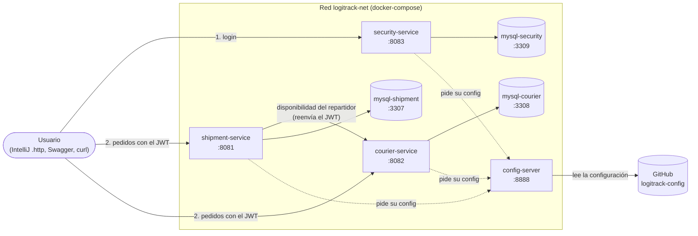

# daas-proyecto-final · LogiTrack

Proyecto de **Desarrollo y Arquitecturas Avanzadas de Software** (FI UNJu 2026) organizado como
**monorepo Maven multi-módulo**. El **Sprint 1** entregó el microservicio de envíos completo; el
**Sprint 2** desacopla la lógica en microservicios independientes, agrega seguridad con JWT y
centraliza la configuración.

| | |
|---|---|
| Lenguaje | Java 25 |
| Framework | Spring Boot 4.0.9 · Spring Cloud 2025.1.1 |
| Base de datos | MySQL 8.4 (H2 en memoria para tests) |
| Documentación | springdoc-openapi (Swagger UI) + Spring Cloud Config |
| Tests | JUnit 5, Mockito, AssertJ, `@DataJpaTest`, `@WebMvcTest`, `@SpringBootTest` |
| Infra | Dockerfile multietapa por microservicio · docker-compose · imágenes en Docker Hub (`macostag26`) |

---

## Módulos

| Módulo | Puerto | Estado | Descripción |
|---|---|---|---|
| [`shipment-service`](shipment-service) | `8081` | ✅ Sprint 1 migrado (S2-01) | Ciclo de vida de envíos, historial de estados y asignación |
| [`courier-service`](courier-service) | `8082` | ✅ Repartidores y disponibilidad (S2-02) | Alta, consulta y disponibilidad de repartidores |
| [`security-service`](security-service) | `8083` | ✅ Usuarios, roles y JWT (S2-05) | Registro, login, BCrypt y emisión de JWT |
| [`config-server`](config-server) | `8888` | ✅ Configuración centralizada (S2-04) | Lee [`logitrack-config`](https://github.com/maxiacostag-cloud/logitrack-config) con perfiles `dev`/`prod` |
| [`common-security`](common-security) | — | ✅ Librería (S2-06) | Resource server JWT compartido: decoder HS256, roles y 401/403 |

> **S2-03 ya desacopló los repartidores:** `shipment-service` no tiene la entidad `Repartidor`; guarda
> un `UUID repartidorId` y consulta la disponibilidad a `courier-service` por REST (`RestClient`).

---

## Arquitectura del Sprint 2

Cada microservicio tiene su propia base y solo habla con los demás por HTTP. Todos toman su
configuración del `config-server` al arrancar, y la seguridad se resuelve con un JWT que firma
`security-service` y validan los otros dos.



- **Login:** el usuario se registra o inicia sesión en `security-service`, que devuelve un JWT con su
  rol (`ADMIN`, `CLIENTE` o `REPARTIDOR`).
- **Validación del token:** `shipment-service` y `courier-service` revisan la firma del JWT con la
  misma clave (`JWT_SECRET`), sin llamar a `security-service` en cada pedido.
- **Entre servicios:** para asignar un repartidor, `shipment-service` consulta la disponibilidad a
  `courier-service` por REST. Si courier no responde, shipment contesta 503.
- **Configuración:** el `config-server` lee el repositorio
  [`logitrack-config`](https://github.com/maxiacostag-cloud/logitrack-config) y le entrega a cada
  servicio su configuración del perfil `dev` (IDE) o `prod` (Docker). Las claves no están en ese
  repositorio: llegan por variables de entorno.
- **Bases de datos:** una por servicio. Ningún servicio lee las tablas de otro.

---

## Inicio rápido: todo el entorno con Docker (Sprint 2)

Solo hace falta **Docker Desktop**. No se compila nada: las imágenes se descargan de Docker Hub.

```bash
git clone https://github.com/maxiacostag-cloud/daas-proyecto-final.git
cd daas-proyecto-final

# Crear el archivo de variables (no se sube al repositorio) y completar los secretos
cp .env.example .env            # Windows: copy .env.example .env

docker compose up -d
docker compose ps               # en 1-2 minutos los 7 contenedores quedan "healthy"
```

En el `.env`, `DOCKERHUB_USER` tiene que ser `macostag26` (el usuario donde están publicadas las
imágenes) e `IMAGE_TAG` la versión, `1.0.0`. Las claves (`DB_PASSWORD`, `MYSQL_ROOT_PASSWORD` y
`JWT_SECRET`) se eligen al crear el entorno; `JWT_SECRET` necesita al menos 32 caracteres.

### Imágenes publicadas (S2-10)

| Imagen | Descarga |
|---|---|
| [`macostag26/logitrack-config-server:1.0.0`](https://hub.docker.com/r/macostag26/logitrack-config-server) | `docker pull macostag26/logitrack-config-server:1.0.0` |
| [`macostag26/logitrack-security-service:1.0.0`](https://hub.docker.com/r/macostag26/logitrack-security-service) | `docker pull macostag26/logitrack-security-service:1.0.0` |
| [`macostag26/logitrack-courier-service:1.0.0`](https://hub.docker.com/r/macostag26/logitrack-courier-service) | `docker pull macostag26/logitrack-courier-service:1.0.0` |
| [`macostag26/logitrack-shipment-service:1.0.0`](https://hub.docker.com/r/macostag26/logitrack-shipment-service) | `docker pull macostag26/logitrack-shipment-service:1.0.0` |

### Qué levanta el compose (S2-09)

| Contenedor | Puerto en la PC | Para qué |
|---|---|---|
| `config-server` | `8888` | Entrega la configuración leída de `logitrack-config` |
| `security-service` | `8083` | Usuarios, login y JWT |
| `courier-service` | `8082` | Repartidores |
| `shipment-service` | `8081` | Envíos (Swagger en http://localhost:8081/swagger-ui.html) |
| `mysql-security` · `mysql-courier` · `mysql-shipment` | `3309` · `3308` · `3307` | Una base por microservicio |

Los servicios arrancan con el perfil **`prod`** y se encuentran por **nombre de servicio** dentro de la
red `logitrack-net` (nunca por `localhost`). Cada uno espera a que su base y el `config-server` estén
sanos antes de arrancar.

### Construir las imágenes desde el código

Para probar cambios propios sin publicarlos, se suma `docker-compose.build.yml`, que construye cada
imagen con el `Dockerfile` multietapa de su módulo (S2-08):

```bash
docker compose -f docker-compose.yml -f docker-compose.build.yml up -d --build
```

Para publicar una versión nueva en Docker Hub (después de `docker login`):

```bash
docker compose -f docker-compose.yml -f docker-compose.build.yml build
docker compose -f docker-compose.yml -f docker-compose.build.yml push
```

### Detener el entorno

```bash
docker compose down        # frena y borra los contenedores
docker compose down -v     # además borra las bases (vuelven a crearse con los datos de prueba)
```

---

## 1. Requisitos

- **JDK 25** (Temurin recomendado)
- **Maven 3.9+** — o usar el wrapper incluido (`mvnw` / `mvnw.cmd`), que no requiere instalación
- **Docker Desktop** (o Docker Engine + Compose v2), solo para la base de datos y para los
  servicios containerizados del Sprint 2

## 2. Build del proyecto completo

```bash
# Linux / macOS
./mvnw -B clean verify

# Windows (PowerShell)
.\mvnw.cmd -B clean verify
```

El reactor compila los cinco módulos y ejecuta toda la suite de tests. Para saltar los tests
durante un build rápido:

```bash
./mvnw -B clean package -DskipTests
```

## 3. Levantar los servicios en local

Cada microservicio se ejecuta desde su propio módulo:

```powershell
.\mvnw.cmd -pl shipment-service spring-boot:run    # http://localhost:8081
.\mvnw.cmd -pl courier-service  spring-boot:run    # http://localhost:8082
.\mvnw.cmd -pl security-service spring-boot:run    # http://localhost:8083
.\mvnw.cmd -pl config-server    spring-boot:run    # http://localhost:8888
```

o directamente desde el IDE ejecutando cada clase `*Application`.

> **Configuración centralizada (S2-04):** primero hay que levantar el `config-server`; los demás
> servicios toman de ahí su puerto, su base y sus URLs (perfil `dev`). Los secretos se pasan como
> variables de entorno en la configuración de ejecución del IDE, por ejemplo:
> `DB_PASSWORD=logitrack;JWT_SECRET=<una clave de al menos 32 caracteres>`.

| Recurso | URL |
|---|---|
| Swagger UI (shipment) | http://localhost:8081/swagger-ui.html |
| OpenAPI JSON (shipment) | http://localhost:8081/v3/api-docs |
| Health (shipment) | http://localhost:8081/actuator/health |
| Config server | http://localhost:8888/shipment-service/dev |

### Bases de datos

Para correr los servicios desde el IDE alcanza con levantar solo las bases:

```bash
docker compose up -d mysql-shipment mysql-courier mysql-security
```

- `logitrack_shipments` en `localhost:3307`, `logitrack_couriers` en `localhost:3308` y
  `logitrack_security_db` en `localhost:3309`. El usuario y la clave son los del `.env`.
- Los scripts de [`db/init`](db/init) cargan el esquema y los datos de prueba **solo la primera vez**
  que se crea cada volumen. Para empezar de cero: `docker compose down -v`.

## 4. Tests

```bash
./mvnw -B test                            # todos los módulos
./mvnw -B -pl shipment-service test       # un módulo
```

La suite **no necesita MySQL ni Docker**: `shipment-service` usa H2 en memoria (modo MySQL) y
`courier-service` desactiva Spring Cloud Config en el perfil de test. El pipeline de GitHub Actions
([`.github/workflows/ci.yml`](.github/workflows/ci.yml)) corre `mvn -B verify` en cada push y pull
request; el resultado se ve en la pestaña **Actions** del repositorio.

El mismo `verify` genera el reporte de cobertura **JaCoCo** de cada módulo
(`<módulo>/target/site/jacoco/index.html`) y GitHub Actions lo publica como artefacto
`cobertura-jacoco`, junto a los `surefire-reports` de los tests.

| Test (`shipment-service`) | Tipo | Qué valida |
|---|---|---|
| `EstadoEnvioTest` | Unitario | Matriz completa de transiciones de la máquina de estados |
| `EnvioTest` | Unitario | Cálculo de tarifa, cancelación, asignación, historial |
| `ShipmentServiceTest` | Unitario (Mockito) | Registro, consultas y reglas de negocio de envíos |
| `AsignacionServiceImplTest` | Unitario (Mockito) | Asignación, reasignación, repartidor no disponible y estados de envío |
| `CourierClientImplTest` | Unitario (`MockRestServiceServer`) | Contrato HTTP con courier-service: 200, 404 y 503 |
| `EnvioRepositoryTest` | Integración (`@DataJpaTest`) | Mapeo JPA, UUID, auditoría y filtro por repartidor |
| `AsignacionControllerTest` / `ShipmentControllerTest` | Integración (`@WebMvcTest`) | Contrato HTTP y códigos 200/201/400/404/409/422/503 |
| `GestionEnviosIntegrationTest` | Integración (`@SpringBootTest`) | Flujo completo e2e sobre H2, con courier-service mockeado |
| `FlujoCompletoHttpE2ETest` | Integración E2E (`@SpringBootTest` + `HttpServer`) | Registrar envío → asignar repartidor → `EN_RUTA` → `ENTREGADO` contra un courier-service falso por **HTTP real** (sin mockear el cliente); el courier falso exige `Authorization` y el test comprueba el **relay del token** |
| `ShipmentSecurityTest` | Integración de seguridad (`@SpringBootTest`, JWT reales) | 401 sin token / vencido / firma inválida, 403 por rol, 200/201 con token válido y endpoints públicos |
| `ShipmentOwnershipTest` | Integración de seguridad (`@SpringBootTest`, JWT reales) | 16 casos de pertenencia: un `CLIENTE` solo ve y cancela lo propio; un `REPARTIDOR` solo su hoja de ruta |
| `AutorizacionEnvioTest` | Unitario (JWT decodificado) | Reglas de lectura, cancelación, cambio de estado, asignación y filtro de listado por rol |
| `ShipmentServiceApplicationTests` | `@SpringBootTest` | El contexto completo levanta |

`courier-service` tiene su propia suite (unitarios, `@DataJpaTest`, `@WebMvcTest` e integración con
H2). `config-server` tiene su test de `contextLoads`, que levanta el servidor sin clonar el
repositorio de configuración (`clone-on-start: false` en el perfil de test).

Tests de `security-service` (perfil `test` con H2, sin MySQL ni Config Server):

| Test | Tipo | Qué valida |
|---|---|---|
| `JwtUtilsTest` | Unitario | Firma, claims (`sub`, `roles`, `repartidorId`), token expirado, firma alterada y texto malformado |
| `AuthControllerIntegrationTest` | Integración (`@SpringBootTest`) | Registro (201/409/422/400), login por username y email, 401 por credenciales o usuario inexistente, `/me` con token válido, sin token, inválido y expirado |
| `SecurityServiceApplicationTests` | `@SpringBootTest` | El contexto levanta con el perfil `test` (H2) |

**S2-07** agregó la autorización por **pertenencia**: un `CLIENTE` solo ve, cancela y asigna sus
propios envíos, y un `REPARTIDOR` solo opera los asignados a su `repartidorId`. La cubren
`ShipmentOwnershipTest` (16 casos HTTP) y `AutorizacionEnvioTest` (10 casos unitarios).

Todos los tests viven dentro de su módulo (`src/test/java`): no quedan tests del Sprint 1 huérfanos
en la raíz del reactor.

Tests de `courier-service`:

| Test | Tipo | Qué valida |
|---|---|---|
| `RepartidorServiceImplTest` | Unitario (Mockito) | Registro, listados, actualización, cambio de estado y disponibilidad |
| `RepartidorControllerTest` | Integración (`@WebMvcTest`) | Contrato HTTP de los seis endpoints (200/201/400/404/409) |
| `RepartidorRepositoryTest` | Integración (`@DataJpaTest`) | Mapeo JPA, UUID, auditoría, email único |
| `GestionRepartidoresIntegrationTest` | Integración (`@SpringBootTest`) | Flujo completo y disponibilidad sobre H2 |
| `CourierSecurityTest` | Integración de seguridad (`@SpringBootTest`, JWT reales) | 401 sin token / vencido / firma inválida, 403 al gestionar repartidores sin `ADMIN`, consultas autenticadas y endpoints públicos |

## 5. Estructura del repositorio

```
daas-proyecto-final
├── pom.xml                  agregador: Spring Boot 4.0.9 + Spring Cloud 2025.1.1
├── common-security/         librería compartida del resource server JWT (S2-06)
│   └── src/main/java/ar/edu/unju/fi/logitrack/common/security
├── config-server/           Spring Cloud Config Server
├── shipment-service/        envíos (código del Sprint 1)
│   └── src/main/java/ar/edu/unju/fi/logitrack/shipment
│       ├── client/          cliente REST hacia courier-service (RestClient + disponibilidad)
│       ├── config/          JPA auditing, OpenAPI y matriz de autorización
│       ├── controller/      REST controllers (solo reciben/devuelven DTOs)
│       ├── dto/             records de request/response (dto/envio, dto/asignacion, dto/courier)
│       ├── entity/          entidades JPA + enums + Value Object Direccion
│       ├── exception/       excepciones de dominio + GlobalExceptionHandler (RFC 7807)
│       ├── mapper/          conversión entidad ⇄ DTO
│       ├── repository/      Spring Data JPA
│       ├── security/        identidad del JWT y autorización por pertenencia (S2-07)
│       └── service/         contratos de la lógica de aplicación
│           └── impl/        implementaciones (@Service) con las transacciones
├── courier-service/         repartidores + disponibilidad (puerto 8082)
├── security-service/        autenticación y JWT (S2-05)
├── db/init/                 esquema y datos iniciales de MySQL
└── http/                    requests de demo para IntelliJ / REST Client
```

El código del Sprint 1 se movió de `src/` a `shipment-service/src/` en **S2-01**, sin cambios de
paquete (`ar.edu.unju.fi.logitrack.shipment`).

---

## Modelo de dominio (`shipment-service`)


`repartidorId` es solo un UUID: no hay relación JPA ni FK. El repartidor (nombre, vehículo, estado)
vive en `courier-service`, que es el dueño de esos datos.

Los cambios respecto del modelo guía del PDF están explicados en la [sección 8](#8-modelo-de-dominio--cambios-respecto-del-modelo-guía).

## 6. API (`shipment-service`)

Base: `/api/v1`. Errores en formato `application/problem+json`:
400 (validación / formato), 404 (no existe), 409 (dato duplicado), 422 (regla de negocio) y
503 (courier-service no disponible).

| Método | Endpoint | Descripción | Rol mínimo |
|---|---|---|---|
| PUT | `/envios/{id}/repartidor` | Asignar repartidor `{ "repartidorId": "..." }`; consulta courier-service | `ADMIN` o `CLIENTE` |
| POST | `/envios` | Registrar envío (cliente, origen, destino, peso, medidas) | `ADMIN` o `CLIENTE` |
| GET | `/envios/{id}` | Consultar por id | autenticado (pertenencia) |
| GET | `/envios/seguimiento/{codigo}` | Consultar por código de seguimiento | autenticado (pertenencia) |
| GET | `/envios?estado=PENDIENTE&repartidorId=...` | Listar por estado y/o por repartidor asignado (hoja de ruta); el CLIENTE solo ve lo propio y el REPARTIDOR su hoja de ruta | autenticado (pertenencia) |
| PATCH | `/envios/{id}/estado` | Cambiar estado `{ "estado": "EN_RUTA" }` | `ADMIN` o repartidor asignado |
| POST | `/envios/{id}/cancelacion` | Cancelar (solo PENDIENTE) | `ADMIN` o cliente dueño |
| GET | `/envios/{id}/historial` | Historial de estados | autenticado (pertenencia) |

### Seguridad (S2-06)

`shipment-service` y `courier-service` son **resource servers**: no emiten tokens, solo validan los
JWT que emite `security-service`.

- **Firma:** HS256 con el secreto compartido `JWT_SECRET`, que llega por variable de entorno (en Docker
  desde el `.env`; desde el IDE, en la configuración de ejecución). Los tres servicios tienen que usar
  el mismo valor, de al menos 32 caracteres.
- **Roles:** el claim `roles` del token (`["ADMIN"]`, `["CLIENTE"]`, `["REPARTIDOR"]`) se traduce a
  autoridades `ROLE_*`.
- **Endpoints públicos** (sin token): `/actuator/health`, `/actuator/info`, `/v3/api-docs/**`,
  `/swagger-ui/**` y `/error`.
- **Resto:** requiere `Authorization: Bearer <token>`. Las respuestas de seguridad también son
  `ProblemDetail` (`401` con título *No autorizado*, `403` con *Acceso denegado*).
- **Token relay:** cuando `shipment-service` llama a `courier-service` (disponibilidad del repartidor)
  reenvía el `Authorization` del request original, de modo que la llamada interna conserva la
  identidad del usuario y courier sigue exigiendo token.

```bash
# 1. Obtener el token en security-service
curl -X POST http://localhost:8083/api/v1/auth/login \
  -H "Content-Type: application/json" \
  -d '{"usernameOrEmail":"admin.demo","password":"admin123"}'

# 2. Usarlo en shipment o courier
curl http://localhost:8081/api/v1/envios -H "Authorization: Bearer <token>"
```

### Autorización por pertenencia (S2-07)

El rol no alcanza: además se verifica que el recurso **pertenezca** al usuario autenticado. Las
reglas viven en `security/AutorizacionEnvio` (capa de servicio), así valen para todos los puntos de
entrada, y una violación devuelve **403** con `ProblemDetail` (*Acceso denegado*).

| Rol | Lectura (detalle, seguimiento, historial, listado) | Cancelar | Cambiar estado | Asignar repartidor |
|---|---|---|---|---|
| `ADMIN` | Todos los envíos | Sí | Sí | Sí |
| `CLIENTE` | Solo los de su cliente | Solo los propios | No | Solo los propios |
| `REPARTIDOR` | Solo los asignados a él | No | Solo los asignados a él | No |

**Identidad del `CLIENTE`.** El `sub` del JWT (UUID del usuario de `security-service`) se guarda en
`clientes.usuario_id`. Al registrar un envío, el cliente que se crea —o que se reutiliza por email—
queda vinculado a ese usuario, y a partir de ahí solo el dueño puede verlo, cancelarlo o asignarle
repartidor. Si el cliente ya pertenece a otro usuario, el registro responde 403.

> **Simplificación:** el primer `CLIENTE` que usa un email sin dueño *reclama* el registro. Alcanza
> para el alcance del sprint; un modelo completo necesitaría un alta de clientes explícita en
> `security-service`.

**Identidad del `REPARTIDOR`.** El token de un repartidor incluye el claim `repartidorId`, que se
compara con `envios.repartidor_id`. El listado (`GET /envios`) queda atado a la hoja de ruta propia:
pedir `?repartidorId=<otro>` devuelve 403, y un token sin el claim tampoco puede listar.

```bash
# CLIENTE: solo ve sus propios envíos
curl http://localhost:8081/api/v1/envios -H "Authorization: Bearer <token-cliente>"

# REPARTIDOR: solo los asignados a él
curl http://localhost:8081/api/v1/envios -H "Authorization: Bearer <token-repartidor>"

# Envío de otro cliente → 403
curl -i http://localhost:8081/api/v1/envios/<id-ajeno> -H "Authorization: Bearer <token-cliente>"
```

Los tests que cubren la matriz son `AutorizacionEnvioTest` (unitario, por rol),
`ShipmentOwnershipTest` (HTTP con JWT reales y H2) y `ShipmentSecurityTest` (401/403 por rol).

El CRUD de repartidores **no** vive acá: está en `courier-service` (ver más abajo). `shipment-service`
solo guarda el `UUID` del repartidor asignado y consulta su disponibilidad por REST.

### Demo de endpoints

Los archivos [`http/envios.http`](http/envios.http) (ciclo de vida del envío),
[`http/repartidores.http`](http/repartidores.http) (asignación desde shipment) y
[`http/couriers.http`](http/couriers.http) (alta y estado de repartidores) tienen los requests
listos para ejecutar desde IntelliJ IDEA o VS Code (extensión REST Client). Para probar la
asignación tienen que estar levantados `shipment-service` (8081) y `courier-service` (8082).
[`http/pertenencia.http`](http/pertenencia.http) recorre el flujo completo de S2-07: alta y login
de dos clientes y un repartidor, y los 403 por pertenencia.

1. **Asignación exitosa:** `PUT /api/v1/envios/{envioId}/repartidor` con repartidor activo y envío en `PENDIENTE` (200 OK).
2. **Reasignación:** sobre un envío que ya tiene repartidor pero sigue `PENDIENTE` (200 OK).
3. **Rechazo por inactivo:** repartidor en `INACTIVO` (422, lo informa courier-service).
4. **Rechazo por estado de envío:** envío en `EN_RUTA` o `CANCELADO` (422).
5. **Repartidor inexistente:** courier-service responde 404 y shipment lo propaga (404).
6. **courier-service caído:** shipment responde 503.

### API de `courier-service` (8082)

| Método | Endpoint | Descripción | Rol mínimo |
|---|---|---|---|
| POST | `/api/v1/repartidores` | Registrar repartidor (queda `ACTIVO`) | `ADMIN` |
| GET | `/api/v1/repartidores?estado=ACTIVO` | Listar repartidores; filtro opcional por estado | autenticado |
| GET | `/api/v1/repartidores/{id}` | Detalle de un repartidor | autenticado |
| PUT | `/api/v1/repartidores/{id}` | Actualizar nombre, vehículo, email y teléfono | `ADMIN` |
| PATCH | `/api/v1/repartidores/{id}/estado` | Activar o desactivar | `ADMIN` |
| GET | `/api/v1/repartidores/{id}/disponibilidad` | **Disponibilidad para shipment-service** | autenticado |

Respuesta del endpoint de disponibilidad:

```json
{ "repartidorId": "3f6c1a52-8e0b-4d7a-9c11-0a1b2c3d4e01", "estado": "ACTIVO", "disponible": true }
```

`disponible` es `true` solo si el repartidor está `ACTIVO`. Demo: [`http/couriers.http`](http/couriers.http).

> **Limitación conocida:** courier-service no conoce los envíos, así que no puede impedir que se
> desactive un repartidor que tiene un envío `EN_RUTA`. La validación que existía en el `shipment-service`
> monolítico se pierde en este desacople; si se necesita, hay que resolverla con un evento o con una
> consulta de shipment a courier (follow-up).

## 7. Reglas de negocio (`shipment-service`)

- Flujo: `PENDIENTE → EN_RUTA → ENTREGADO`, o `PENDIENTE → CANCELADO`. Cualquier otra transición → 422.
- Solo se cancela en `PENDIENTE`.
- Para pasar a `EN_RUTA` el envío debe tener `repartidorId`; solo se asignan repartidores que
  courier-service informa como disponibles a envíos `PENDIENTE`.
- La asignación consulta `GET /api/v1/repartidores/{id}/disponibilidad` con `courier.service.url`
  (`COURIER_SERVICE_URL`, por defecto `http://localhost:8082`). Un 404 remoto se traduce a 404 y
  un error de conexión o 5xx a 503.
- **Tarifa** (provisoria, a validar con el equipo): `1500 + 450 × máx(peso real, peso volumétrico)`,
  con peso volumétrico = `alto × ancho × largo / 5000`. Las constantes están en `Envio`.

## 8. Modelo de dominio — cambios respecto del modelo guía

| Cambio | Motivo |
|---|---|
| `BaseEntity` con `id` UUID, `createdAt`, `updatedAt` y `version` | Requisito de UUID + auditoría en **todas** las entidades; `@Version` evita actualizaciones perdidas |
| Nueva entidad `HistorialEstado` | Trazabilidad de cada cambio de estado (estado anterior, nuevo, fecha/hora) |
| `BigDecimal` en lugar de `Double` para peso, medidas y tarifa | Evitar errores de redondeo con dinero |
| `TipoVehiculo` enum (en `courier-service`) | Valores consistentes y validables |
| `Direccion` como `@Embeddable` inmutable | Value Object sin identidad; se guarda en columnas `origen_*` / `destino_*` |
| Máquina de estados en `EstadoEnvio.transicionesPermitidas()` | Una sola fuente de verdad para las transiciones |
| `Envio` sin setters: `cambiarEstado()`, `cancelar()`, `asignarRepartidor()` | Las reglas no se pueden saltear; cada cambio de estado agrega historial automáticamente |
| Código de seguimiento `LT-XXXXXXXXXX` (`TrackingCodeGenerator`) | Legible, sin caracteres ambiguos |

## Checklist del Sprint 2

Repaso de cada requisito de la consigna y dónde quedó resuelto. Todos los puntos están cumplidos,
salvo el API Gateway, que queda fuera del alcance de este sprint.

| Requisito de la consigna | Dónde está | Issue |
|---|---|---|
| shipment mantiene registro, consulta, cancelación, cambio de estado e historial | `ShipmentController`, `ShipmentServiceImpl` | S2-01 |
| shipment deja de gestionar repartidores y guarda solo el `repartidorId` | Entidad `Envio` (sin relación JPA con repartidor) | S2-03 |
| shipment consulta a courier por REST y maneja los errores de comunicación | `CourierClientImpl`: un 404 remoto da 404 y una caída da 503 | S2-03 |
| courier registra, consulta, lista, actualiza y cambia el estado `ACTIVO`/`INACTIVO` | `RepartidorController` | S2-02 |
| courier valida la disponibilidad del repartidor | `GET /api/v1/repartidores/{id}/disponibilidad` | S2-02 |
| courier con MySQL propia, DTOs y manejo global de excepciones | `mysql-courier`, `dto/repartidor`, `GlobalExceptionHandler` | S2-02 |
| security registra usuarios con contraseña encriptada (BCrypt) | `AuthController` (`/register`), `SecurityConfig` | S2-05 |
| security autentica y emite un JWT firmado; endpoints de registro, login y usuario actual | `/register`, `/login`, `/me`, `JwtUtils` | S2-05 |
| Roles `ADMIN`, `CLIENTE` y `REPARTIDOR` con Spring Security | Enum `Rol` y claim `roles` del JWT | S2-05 |
| shipment y courier validan el JWT sin llamar a security en cada pedido | `common-security` (`ResourceServerSecurityConfig`) | S2-06 |
| Autorización por rol y por pertenencia del recurso | `SecurityConfig` de cada servicio, `AutorizacionEnvio` | S2-06, S2-07 |
| Config Server con `@EnableConfigServer` y repositorio Git | `config-server` + [`logitrack-config`](https://github.com/maxiacostag-cloud/logitrack-config) | S2-04 |
| Puerto, nombre, MySQL, URLs, logging y seguridad no sensible externalizados, con perfiles `dev` y `prod` | Archivos `<servicio>.yml`, `<servicio>-dev.yml` y `<servicio>-prod.yml` de `logitrack-config` | S2-04 |
| Los servicios usan `spring.config.import`; los secretos van por variables de entorno | `application.yml` de cada servicio, `.env.example` | S2-04 |
| Dockerfile multietapa por servicio, con Java 25 y sin credenciales | `<módulo>/Dockerfile` y `<módulo>/Dockerfile.dockerignore` | S2-08 |
| Compose con los 4 servicios y MySQL, sin `localhost` entre contenedores, con `docker compose up -d` | `docker-compose.yml` | S2-09 |
| 4 imágenes en Docker Hub con etiqueta explícita; el compose funciona sin build local | `macostag26/logitrack-*:1.0.0` | S2-10 |
| Tests unitarios, de integración, de seguridad y E2E, y CI multi-módulo | Sección 4 y [`.github/workflows/ci.yml`](.github/workflows/ci.yml) | S2-11 |
| Verificación de punta a punta, demo y README | Archivos de [`http/`](http) y este README | S2-12 |
| API Gateway | Fuera del alcance del Sprint 2 | — |

## 9. Flujo de trabajo en Git

- `main`: versión entregable, protegida (solo pull requests).
- `develop`: integración del sprint.
- `feature/<sprint>-<issue>-<descripcion-corta>` → pull request hacia `develop`, con al menos una revisión.
- Commits estilo *Conventional Commits*: `feat: ...`, `fix: ...`, `test: ...`, `docs: ...`, `chore: ...`.
- Una rama por issue; el número de issue va en el commit (`Closes #17`) para cerrarla al mergear.

### Issues del Sprint 2

| Issue | Tarea | Rama |
|---|---|---|
| S2-01 | Migrar el código del Sprint 1 al módulo `shipment-service` y unificar el build | `feature/s2-01-migrar-shipment-service` |
| S2-02 | `courier-service`: repartidores y endpoint de disponibilidad | `feature/s2-02-courier-service` |
| S2-03 | `shipment-service`: quitar `Repartidor` y cliente REST hacia courier | `feature/s2-03-shipment-rest-courier` |
| S2-04 | `config-server`: configuración centralizada con perfiles `dev`/`prod` | `feature/s2-04-config-server` |
| S2-05 | `security-service`: usuarios, roles, BCrypt y JWT | `feature/s2-05-security-service` |
| S2-06 | Proteger endpoints con resource server JWT | `feature/s2-06-resource-server` |
| S2-07 | Autorización por pertenencia (`CLIENTE` / `REPARTIDOR`) | `feature/s2-07-autorizacion-pertenencia` |
| S2-08 | Dockerfiles multietapa por microservicio | `feature/s2-08-dockerfiles` |
| S2-09 | `docker-compose` completo (4 servicios + MySQL) | `feature/s2-09-compose` |
| S2-10 | Publicar las imágenes en Docker Hub | `feature/s2-10-docker-hub` |
| S2-11 | Tests integrales y CI multi-módulo | `feature/s2-11-tests-ci` |
| S2-12 | Demo E2E y README final | `feature/s2-12-demo-readme` |

## 10. Créditos

- **Brian Fabalos** — estructura multi-módulo Maven y esqueletos base de `shipment-service`,
  `courier-service`, `security-service` y `config-server` (commit `464e276`, punto de partida del Sprint 2).
- **Facundo Arancibia** — migración del Sprint 1 a `shipment-service`, unificación de Spring Boot y
  Spring Cloud, y suite de tests del microservicio de envíos.
- **Maximiliano Acosta** — coordinación del repositorio, tablero de issues y despliegue.
