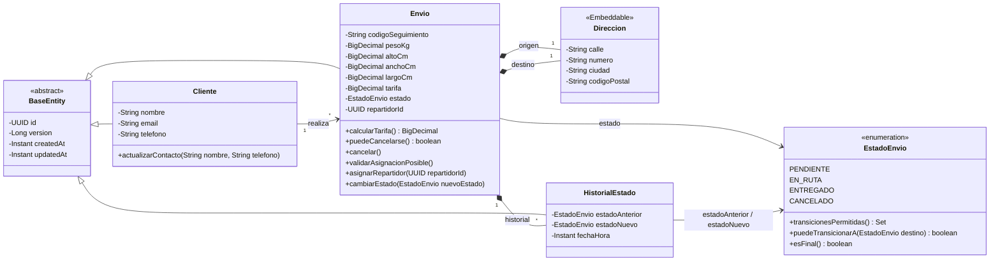

# daas-proyecto-final · LogiTrack

Proyecto de **Desarrollo y Arquitecturas Avanzadas de Software** (FI UNJu 2026) organizado como
**monorepo Maven multi-módulo**. El **Sprint 1** entregó el microservicio de envíos completo; el
**Sprint 2** desacopla la lógica en microservicios independientes, agrega seguridad con JWT y
centraliza la configuración.

| | |
|---|---|
| Lenguaje | Java 25 |
| Framework | Spring Boot 4.0.9 · Spring Cloud 2025.1.1 |
| Base de datos | MySQL 8.4 (H2 en memoria para tests) |
| Documentación | springdoc-openapi (Swagger UI) + Spring Cloud Config |
| Tests | JUnit 5, Mockito, AssertJ, `@DataJpaTest`, `@WebMvcTest`, `@SpringBootTest` |
| Infra | Docker multi-stage + docker-compose (en progreso, S2-08/S2-09) |

---

## Módulos

| Módulo | Puerto | Estado | Descripción |
|---|---|---|---|
| [`shipment-service`](shipment-service) | `8081` | ✅ Sprint 1 migrado (S2-01) | Ciclo de vida de envíos, historial de estados y asignación |
| [`courier-service`](courier-service) | `8082` | ✅ Repartidores y disponibilidad (S2-02) | Alta, consulta y disponibilidad de repartidores |
| [`security-service`](security-service) | `8083` | 🚧 Esqueleto (S2-05) | Usuarios, roles, BCrypt y emisión de JWT |
| [`config-server`](config-server) | `8888` | 🚧 Esqueleto (S2-04) | Configuración centralizada con perfiles `dev`/`prod` |

> **S2-03 ya desacopló los repartidores:** `shipment-service` no tiene la entidad `Repartidor`; guarda
> un `UUID repartidorId` y consulta la disponibilidad a `courier-service` por REST (`RestClient`).

---

## 1. Requisitos

- **JDK 25** (Temurin recomendado)
- **Maven 3.9+** — o usar el wrapper incluido (`mvnw` / `mvnw.cmd`), que no requiere instalación
- **Docker Desktop** (o Docker Engine + Compose v2), solo para la base de datos y para los
  servicios containerizados del Sprint 2

## 2. Build del proyecto completo

```bash
# Linux / macOS
./mvnw -B clean verify

# Windows (PowerShell)
.\mvnw.cmd -B clean verify
```

El reactor compila los cuatro módulos y ejecuta toda la suite de tests. Para saltar los tests
durante un build rápido:

```bash
./mvnw -B clean package -DskipTests
```

## 3. Levantar los servicios en local

Cada microservicio se ejecuta desde su propio módulo:

```powershell
.\mvnw.cmd -pl shipment-service spring-boot:run    # http://localhost:8081
.\mvnw.cmd -pl courier-service  spring-boot:run    # http://localhost:8082
.\mvnw.cmd -pl security-service spring-boot:run    # http://localhost:8083
.\mvnw.cmd -pl config-server    spring-boot:run    # http://localhost:8888
```

o directamente desde el IDE ejecutando cada clase `*Application`.

| Recurso | URL |
|---|---|
| Swagger UI (shipment) | http://localhost:8081/swagger-ui.html |
| OpenAPI JSON (shipment) | http://localhost:8081/v3/api-docs |
| Health (shipment) | http://localhost:8081/actuator/health |
| Config server | http://localhost:8888/shipment-service/default |

### Base de datos

```bash
docker compose up -d mysql
```

- MySQL en `localhost:3307` · usuario `logitrack` / `logitrack`
- Bases: `logitrack_shipments` (shipment) y `logitrack_couriers` (courier)
- El script [`db/init/01-schema.sql`](db/init/01-schema.sql) crea el esquema de envíos **solo la
  primera vez** que se crea el volumen. Para empezar de cero:

  ```bash
  docker compose down -v
  ```

Los valores por defecto se pueden pisar con variables de entorno: `DB_HOST`, `DB_PORT`, `DB_NAME`,
`DB_USER`, `DB_PASSWORD`, `SERVER_PORT` y `CONFIG_SERVER_URL`. Ver [`.env.example`](.env.example).

> `docker compose up --build` todavía construye la imagen única del Sprint 1: los Dockerfiles por
> microservicio y el compose completo son **S2-08** y **S2-09**.

## 4. Tests

```bash
./mvnw -B test                            # todos los módulos
./mvnw -B -pl shipment-service test       # un módulo
```

La suite **no necesita MySQL ni Docker**: `shipment-service` usa H2 en memoria (modo MySQL) y
`courier-service` desactiva Spring Cloud Config en el perfil de test. El pipeline de GitHub Actions
([`.github/workflows/ci.yml`](.github/workflows/ci.yml)) corre `mvn -B verify` en cada push y pull
request; el resultado se ve en la pestaña **Actions** del repositorio.

| Test (`shipment-service`) | Tipo | Qué valida |
|---|---|---|
| `EstadoEnvioTest` | Unitario | Matriz completa de transiciones de la máquina de estados |
| `EnvioTest` | Unitario | Cálculo de tarifa, cancelación, asignación, historial |
| `ShipmentServiceTest` | Unitario (Mockito) | Registro, consultas y reglas de negocio de envíos |
| `AsignacionServiceImplTest` | Unitario (Mockito) | Asignación, reasignación, repartidor no disponible y estados de envío |
| `CourierClientImplTest` | Unitario (`MockRestServiceServer`) | Contrato HTTP con courier-service: 200, 404 y 503 |
| `EnvioRepositoryTest` | Integración (`@DataJpaTest`) | Mapeo JPA, UUID, auditoría y filtro por repartidor |
| `AsignacionControllerTest` / `ShipmentControllerTest` | Integración (`@WebMvcTest`) | Contrato HTTP y códigos 200/201/400/404/409/422/503 |
| `GestionEnviosIntegrationTest` | Integración (`@SpringBootTest`) | Flujo completo e2e sobre H2, con courier-service mockeado |
| `ShipmentServiceApplicationTests` | `@SpringBootTest` | El contexto completo levanta |

`courier-service` tiene su propia suite (unitarios, `@DataJpaTest`, `@WebMvcTest` e integración con
H2). `security-service` y `config-server` tienen por ahora su test de `contextLoads`; la cobertura
propia se agrega en S2-04, S2-05 y S2-11.

Tests de `courier-service`:

| Test | Tipo | Qué valida |
|---|---|---|
| `RepartidorServiceImplTest` | Unitario (Mockito) | Registro, listados, actualización, cambio de estado y disponibilidad |
| `RepartidorControllerTest` | Integración (`@WebMvcTest`) | Contrato HTTP de los seis endpoints (200/201/400/404/409) |
| `RepartidorRepositoryTest` | Integración (`@DataJpaTest`) | Mapeo JPA, UUID, auditoría, email único |
| `GestionRepartidoresIntegrationTest` | Integración (`@SpringBootTest`) | Flujo completo y disponibilidad sobre H2 |

## 5. Estructura del repositorio

```
daas-proyecto-final
├── pom.xml                  agregador: Spring Boot 4.0.9 + Spring Cloud 2025.1.1
├── config-server/           Spring Cloud Config Server
├── shipment-service/        envíos (código del Sprint 1)
│   └── src/main/java/ar/edu/unju/fi/logitrack/shipment
│       ├── client/          cliente REST hacia courier-service (RestClient + disponibilidad)
│       ├── config/          JPA auditing, OpenAPI
│       ├── controller/      REST controllers (solo reciben/devuelven DTOs)
│       ├── dto/             records de request/response (dto/envio, dto/asignacion, dto/courier)
│       ├── entity/          entidades JPA + enums + Value Object Direccion
│       ├── exception/       excepciones de dominio + GlobalExceptionHandler (RFC 7807)
│       ├── mapper/          conversión entidad ⇄ DTO
│       ├── repository/      Spring Data JPA
│       └── service/         contratos de la lógica de aplicación
│           └── impl/        implementaciones (@Service) con las transacciones
├── courier-service/         repartidores + disponibilidad (puerto 8082)
├── security-service/        autenticación y JWT (esqueleto)
├── db/init/                 esquema y datos iniciales de MySQL
└── http/                    requests de demo para IntelliJ / REST Client
```

El código del Sprint 1 se movió de `src/` a `shipment-service/src/` en **S2-01**, sin cambios de
paquete (`ar.edu.unju.fi.logitrack.shipment`).

---

## Modelo de dominio (`shipment-service`)



`repartidorId` es solo un UUID: no hay relación JPA ni FK. El repartidor (nombre, vehículo, estado)
vive en `courier-service`, que es el dueño de esos datos.

Los cambios respecto del modelo guía del PDF están explicados en la [sección 8](#8-modelo-de-dominio--cambios-respecto-del-modelo-guía).

## 6. API (`shipment-service`)

Base: `/api/v1`. Errores en formato `application/problem+json`:
400 (validación / formato), 404 (no existe), 409 (dato duplicado), 422 (regla de negocio) y
503 (courier-service no disponible).

| Método | Endpoint | Descripción | Estado |
|---|---|---|---|
| PUT | `/envios/{id}/repartidor` | Asignar repartidor `{ "repartidorId": "..." }`; consulta courier-service | ✅ |
| POST | `/envios` | Registrar envío (cliente, origen, destino, peso, medidas) | ✅ |
| GET | `/envios/{id}` | Consultar por id | ✅ |
| GET | `/envios/seguimiento/{codigo}` | Consultar por código de seguimiento | ✅ |
| GET | `/envios?estado=PENDIENTE&repartidorId=...` | Listar por estado y/o por repartidor asignado (hoja de ruta) | ✅ |
| PATCH | `/envios/{id}/estado` | Cambiar estado `{ "estado": "EN_RUTA" }` | ✅ |
| POST | `/envios/{id}/cancelacion` | Cancelar (solo PENDIENTE) | ✅ |
| GET | `/envios/{id}/historial` | Historial de estados | ✅ |

El CRUD de repartidores **no** vive acá: está en `courier-service` (ver más abajo). `shipment-service`
solo guarda el `UUID` del repartidor asignado y consulta su disponibilidad por REST.

### Demo de endpoints

Los archivos [`http/envios.http`](http/envios.http) (ciclo de vida del envío),
[`http/repartidores.http`](http/repartidores.http) (asignación desde shipment) y
[`http/couriers.http`](http/couriers.http) (alta y estado de repartidores) tienen los requests
listos para ejecutar desde IntelliJ IDEA o VS Code (extensión REST Client). Para probar la
asignación tienen que estar levantados `shipment-service` (8081) y `courier-service` (8082).

1. **Asignación exitosa:** `PUT /api/v1/envios/{envioId}/repartidor` con repartidor activo y envío en `PENDIENTE` (200 OK).
2. **Reasignación:** sobre un envío que ya tiene repartidor pero sigue `PENDIENTE` (200 OK).
3. **Rechazo por inactivo:** repartidor en `INACTIVO` (422, lo informa courier-service).
4. **Rechazo por estado de envío:** envío en `EN_RUTA` o `CANCELADO` (422).
5. **Repartidor inexistente:** courier-service responde 404 y shipment lo propaga (404).
6. **courier-service caído:** shipment responde 503.

### API de `courier-service` (8082)

| Método | Endpoint | Descripción |
|---|---|---|
| POST | `/api/v1/repartidores` | Registrar repartidor (queda `ACTIVO`) |
| GET | `/api/v1/repartidores?estado=ACTIVO` | Listar repartidores; filtro opcional por estado |
| GET | `/api/v1/repartidores/{id}` | Detalle de un repartidor |
| PUT | `/api/v1/repartidores/{id}` | Actualizar nombre, vehículo, email y teléfono |
| PATCH | `/api/v1/repartidores/{id}/estado` | Activar o desactivar |
| GET | `/api/v1/repartidores/{id}/disponibilidad` | **Disponibilidad para shipment-service** |

Respuesta del endpoint de disponibilidad:

```json
{ "repartidorId": "3f6c1a52-8e0b-4d7a-9c11-0a1b2c3d4e01", "estado": "ACTIVO", "disponible": true }
```

`disponible` es `true` solo si el repartidor está `ACTIVO`. Demo: [`http/couriers.http`](http/couriers.http).

> **Limitación conocida:** courier-service no conoce los envíos, así que no puede impedir que se
> desactive un repartidor que tiene un envío `EN_RUTA`. La validación que existía en el `shipment-service`
> monolítico se pierde en este desacople; si se necesita, hay que resolverla con un evento o con una
> consulta de shipment a courier (follow-up).

## 7. Reglas de negocio (`shipment-service`)

- Flujo: `PENDIENTE → EN_RUTA → ENTREGADO`, o `PENDIENTE → CANCELADO`. Cualquier otra transición → 422.
- Solo se cancela en `PENDIENTE`.
- Para pasar a `EN_RUTA` el envío debe tener `repartidorId`; solo se asignan repartidores que
  courier-service informa como disponibles a envíos `PENDIENTE`.
- La asignación consulta `GET /api/v1/repartidores/{id}/disponibilidad` con `courier.service.url`
  (`COURIER_SERVICE_URL`, por defecto `http://localhost:8082`). Un 404 remoto se traduce a 404 y
  un error de conexión o 5xx a 503.
- **Tarifa** (provisoria, a validar con el equipo): `1500 + 450 × máx(peso real, peso volumétrico)`,
  con peso volumétrico = `alto × ancho × largo / 5000`. Las constantes están en `Envio`.

## 8. Modelo de dominio — cambios respecto del modelo guía

| Cambio | Motivo |
|---|---|
| `BaseEntity` con `id` UUID, `createdAt`, `updatedAt` y `version` | Requisito de UUID + auditoría en **todas** las entidades; `@Version` evita actualizaciones perdidas |
| Nueva entidad `HistorialEstado` | Trazabilidad de cada cambio de estado (estado anterior, nuevo, fecha/hora) |
| `BigDecimal` en lugar de `Double` para peso, medidas y tarifa | Evitar errores de redondeo con dinero |
| `TipoVehiculo` enum (en `courier-service`) | Valores consistentes y validables |
| `Direccion` como `@Embeddable` inmutable | Value Object sin identidad; se guarda en columnas `origen_*` / `destino_*` |
| Máquina de estados en `EstadoEnvio.transicionesPermitidas()` | Una sola fuente de verdad para las transiciones |
| `Envio` sin setters: `cambiarEstado()`, `cancelar()`, `asignarRepartidor()` | Las reglas no se pueden saltear; cada cambio de estado agrega historial automáticamente |
| Código de seguimiento `LT-XXXXXXXXXX` (`TrackingCodeGenerator`) | Legible, sin caracteres ambiguos |

## 9. Flujo de trabajo en Git

- `main`: versión entregable, protegida (solo pull requests).
- `develop`: integración del sprint.
- `feature/<sprint>-<issue>-<descripcion-corta>` → pull request hacia `develop`, con al menos una revisión.
- Commits estilo *Conventional Commits*: `feat: ...`, `fix: ...`, `test: ...`, `docs: ...`, `chore: ...`.
- Una rama por issue; el número de issue va en el commit (`Closes #17`) para cerrarla al mergear.

### Issues del Sprint 2

| Issue | Tarea | Rama |
|---|---|---|
| S2-01 | Migrar el código del Sprint 1 al módulo `shipment-service` y unificar el build | `feature/s2-01-migrar-shipment-service` |
| S2-02 | `courier-service`: repartidores y endpoint de disponibilidad | `feature/s2-02-courier-service` |
| S2-03 | `shipment-service`: quitar `Repartidor` y cliente REST hacia courier | `feature/s2-03-shipment-rest-courier` |
| S2-04 | `config-server`: configuración centralizada con perfiles `dev`/`prod` | `feature/s2-04-config-server` |
| S2-05 | `security-service`: usuarios, roles, BCrypt y JWT | `feature/s2-05-security-service` |
| S2-06 | Proteger endpoints con resource server JWT | `feature/s2-06-resource-server` |
| S2-07 | Autorización por pertenencia (`CLIENTE` / `REPARTIDOR`) | `feature/s2-07-autorizacion` |
| S2-08 | Dockerfiles multietapa por microservicio | `feature/s2-08-dockerfiles` |
| S2-09 | `docker-compose` completo (4 servicios + MySQL) | `feature/s2-09-compose` |
| S2-10 | Publicar las imágenes en Docker Hub | `feature/s2-10-docker-hub` |
| S2-11 | Tests integrales y CI multi-módulo | `feature/s2-11-tests-ci` |
| S2-12 | Demo E2E y README final | `feature/s2-12-demo-readme` |

## 10. Créditos

- **Brian Fabalos** — estructura multi-módulo Maven y esqueletos base de `shipment-service`,
  `courier-service`, `security-service` y `config-server` (commit `464e276`, punto de partida del Sprint 2).
- **Facundo Arancibia** — migración del Sprint 1 a `shipment-service`, unificación de Spring Boot y
  Spring Cloud, y suite de tests del microservicio de envíos.
- **Maximiliano Acosta** — coordinación del repositorio, tablero de issues y despliegue.
